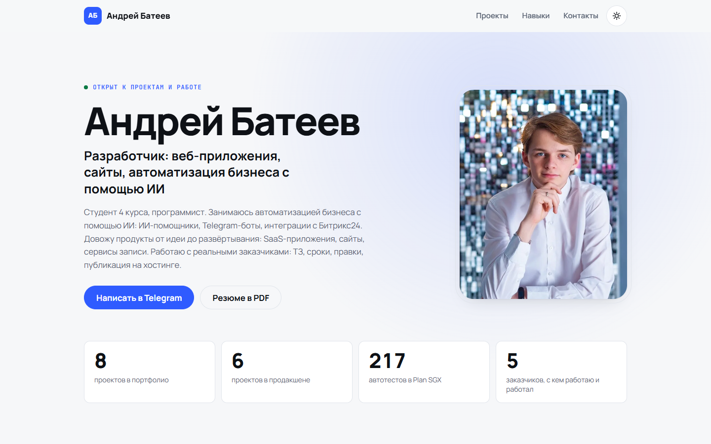
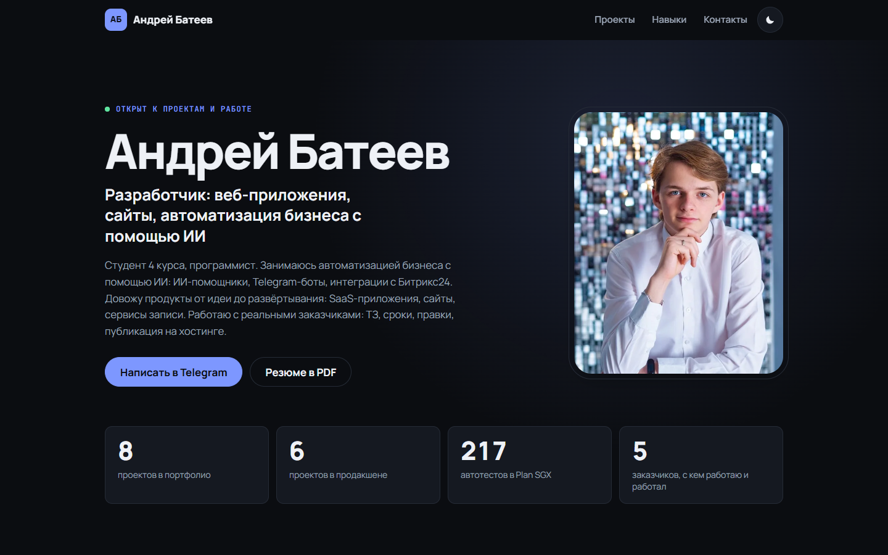
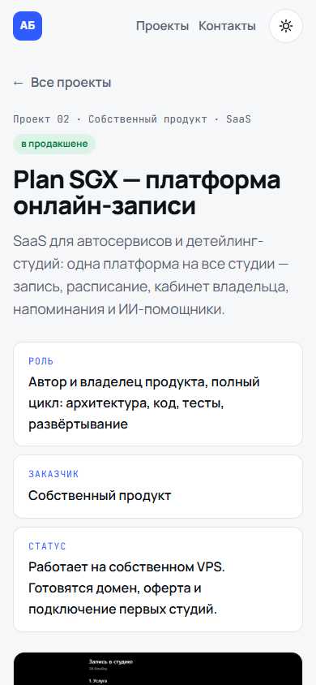

# Портфолио: сайт-визитка и PDF-резюме

Мой сайт-портфолио **[bateevdev.ru](https://bateevdev.ru/)** и PDF-резюме собираются из одних и тех же данных: описаний проектов в `data/`.
Один JSON с проектом превращается и в страницу сайта, и в страницу PDF, поэтому цифры и тексты нигде не расходятся.

| Светлая тема | Тёмная тема | Страница проекта на телефоне |
|---|---|---|
|  |  |  |

## Что внутри

- **Сайт** на [11ty](https://www.11ty.dev/) (Nunjucks), без фреймворков на клиенте. Светлая и тёмная тема, адаптивная вёрстка от 320 до 1920 px, плавные переходы между страницами (View Transitions) с запасным вариантом без них, анимации отключаются при `prefers-reduced-motion`.
- **PDF-резюме**: HTML + CSS, печатается через Chrome (Playwright), с автоматической проверкой, что ничего не вылезло за страницу.
- **Картинки**: скрипт делает из скриншотов адаптивные WebP-варианты и подписывает размеры (`width`/`height`), чтобы страница не прыгала при загрузке.
- **Схемы** (`assets/diagrams/`): HTML-диаграммы архитектуры, которые рендерятся в PNG.
- **SEO**: `canonical`, Open Graph, `sitemap.xml`, `robots.txt`.

## Структура

```
data/profile.json        профиль: имя, контакты, навыки, ключевые цифры
data/projects/*.json     по файлу на проект: описание, цифры, стек, скриншоты
assets/                  фото, шрифты, скриншоты, схемы
site/                    шаблоны 11ty, CSS и JS сайта
tools/                   сборка PDF, картинок, схем; локальный сервер; проверки
```

## Запуск

Нужны Node.js 20+ и Python 3 с Pillow (`pip install pillow`). Для PDF и проверок — установленный Google Chrome.

```bash
npm install
npm run site:build     # картинки + сборка сайта в _site/
npm run site           # локальный просмотр с автообновлением
npm run pdf            # PDF-резюме в out/
```

Свои данные кладутся в `data/profile.json` и `data/projects/`. Поля, которых нет (`null`), в PDF подсвечиваются как TODO.

## Лицензия

Код распространяется под лицензией MIT (см. `LICENSE`). Тексты, фотографии, скриншоты и описания проектов в `data/` и `assets/` — мои, их использование без разрешения не допускается.

Автор: Андрей Батеев, [@nouheart](https://t.me/nouheart).
